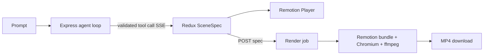

# FrameForge — Prompt to Video

Prompt-driven, deterministic 3D motion graphics with a browser preview and MP4 export. The LLM can only request small, schema-validated scene mutations; it never writes or runs JavaScript or Three.js code.

## Stack and architecture

This is a Vite + React 18 + TypeScript client and a separate Express API in one repository. Express talks to a local Ollama server and owns Remotion rendering, while Vite gives the authoring UI a fast independent dev server. Scene data and Zod schemas live in `shared/sceneSpec.ts` and are imported by both sides.

## Setup

1. Install Node.js 22+, [Ollama](https://ollama.com/download), and ffmpeg (for local MP4 rendering).
2. Pull the selected model: `ollama pull llama3` (or set `OLLAMA_MODEL` to another locally installed model).
3. Run `npm install`.
4. Copy `.env.example` to `.env`. `OLLAMA_BASE_URL` defaults to `http://127.0.0.1:11434`; `OLLAMA_MODEL` defaults to `llama3`.
5. Start Ollama, then run `npm run dev`; open the Vite URL at `http://localhost:5173`.
6. Run `npm run typecheck`, `npm test`, or `npm run build` for validation.

The client talks to the API through the Vite `/api` proxy. Ollama runs on the same machine by default, so prompts and SceneSpec data stay local. If the API cannot reach Ollama, the editor and preview still work and generation reports how to connect it.

## How it works

`POST /api/agent` streams assistant messages and tool calls from Ollama's local `/api/chat` endpoint. Server-side Zod validation rejects malformed tool payloads; the browser applies valid operations through Redux and sends the execution result back to the model. Scene history supports undo and redo. `SceneComposition` renders the same JSON in `@remotion/player` and in Remotion's render bundle. All object animation is derived from Remotion's current frame; scene content never depends on browser wall-clock time or random values.

`POST /api/render` validates the supplied scene, creates an in-memory job, bundles the Remotion entry once per server process, then calls `selectComposition` and `renderMedia`. Poll `GET /api/render/:id`; completed jobs provide a download URL. Jobs and output files are local and in memory for this first version.

## Add a tool or object type

Add/adjust the Zod schema in `shared/sceneSpec.ts`. Add a named input schema and Ollama tool definition in `server/agentTools.ts`. Implement its reducer operation and dispatch in `src/store.ts`, and show the corresponding tool status in the UI. For an object type, add the union variant to `SceneObjectSchema`, then provide its geometry in `src/remotion/SceneComposition.tsx`. Keep changes JSON based and use frame-derived transforms for animation.

## Code layout

- `src/App.tsx` composes the page; `src/components/` contains the UI regions, and `src/hooks/` contains chat and export flows.
- `server/index.ts` starts the API; `server/app.ts` configures middleware and mounts routes.
- `server/routes/` handles HTTP validation and responses; `server/services/` owns Ollama streaming, tool-result coordination, and Remotion jobs.
- `server/agentTools.ts` keeps model-facing tool definitions beside their Zod validators.

## Text and assumptions

Titles use Drei's `Text`, which renders readable SDF text without loading a font file. The default scene contains ambient and directional lights. The local agent uses Ollama's streaming chat and native tool-call format. Tool inputs are checked before streaming to the client and failed tool payloads are described in tool results, allowing the model to correct them. The browser applies valid streamed calls as they arrive. For simplicity the API accepts one generation request per connection and keeps render jobs in memory. Production deployment should replace that map/output folder with a queue and object storage.

## Limitations

- The agent cannot inspect rendered pixels or ask follow-up questions.
- Export requires Chromium and ffmpeg; `Dockerfile` installs these dependencies.
- Only primitive geometry, Drei text, basic lights, and the listed deterministic animation kinds are supported.
- The current streaming transport is one-way after request start; server-side schema validation is the authoritative tool result.
# GenV
